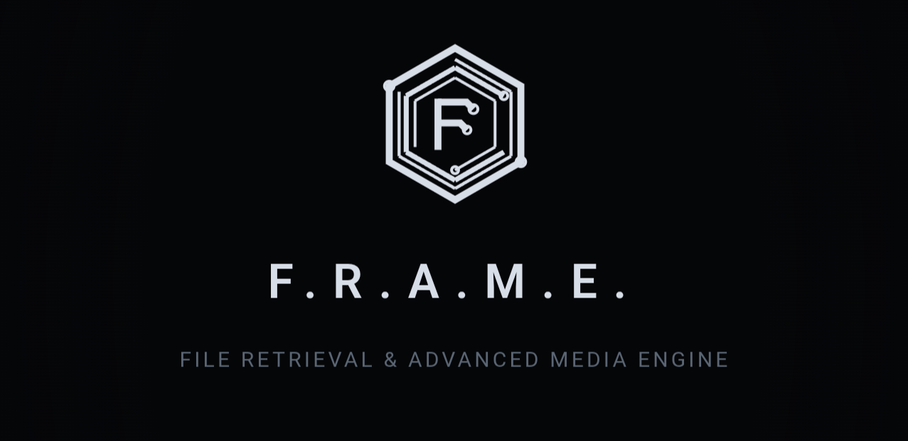
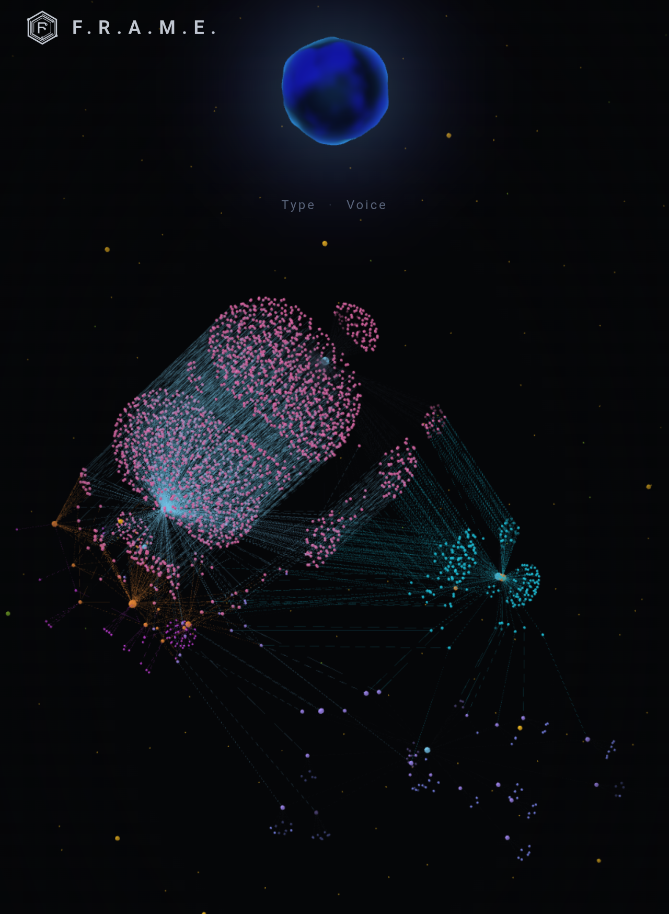
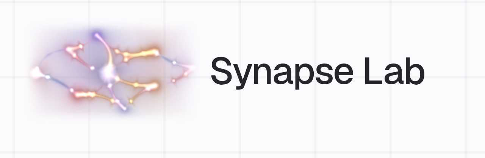
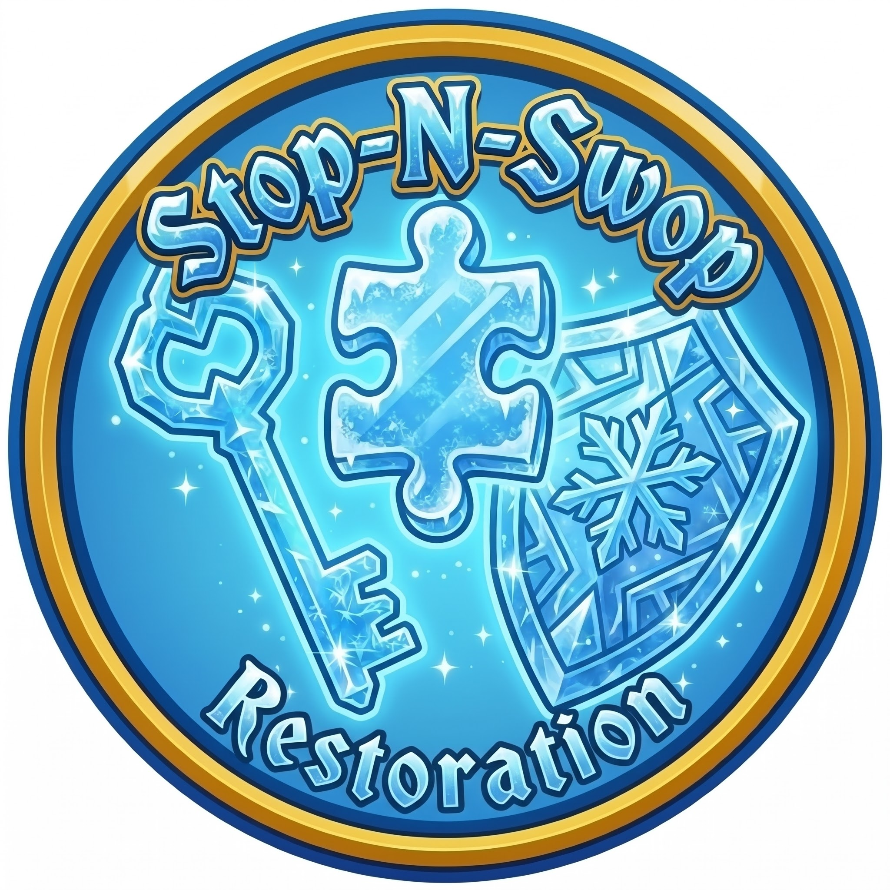
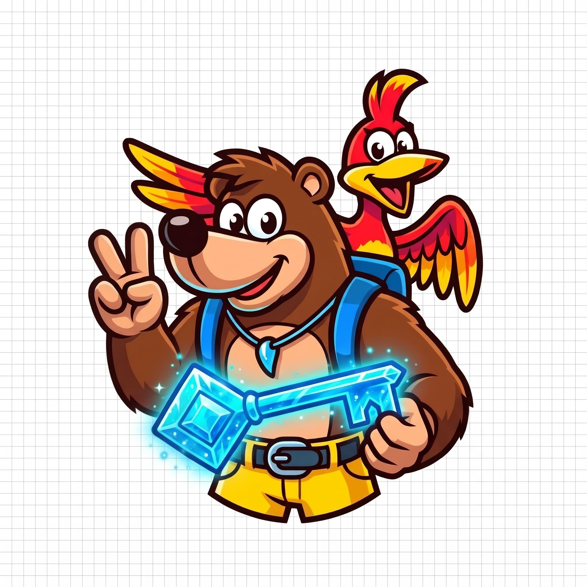

<h1 align="center">0xKnowles</h1>

  <b>Embedded Systems &amp; Full-Stack Engineer</b>

  I build across the whole stack — from hand-tuned C++ firmware for memory-constrained 
  e-ink hardware, to full-stack TypeScript apps, AI agents, and custom-designed PCBs. 
  My background pairs IT infrastructure with deep experience in greenhouse 
  automation and integrated pest management.

  
  
  

---

## Featured Work

### CapyDojo · Shipped Android game &nbsp; &nbsp;

  

A cosy fire/water/ice card battler for Android starring capybaras — **live on Google Play**. A pure-Kotlin, fully unit-tested rules engine with no Android dependencies drives a Jetpack Compose UI, with nine belts, deck building, a Daily Dojo, colour-blind-friendly card shapes and local two-player.

**Kotlin** · Jetpack Compose · Android · test-driven rules engine · [Google Play](https://play.google.com/store/apps/details?id=com.capydojo.app) · [Trailer](https://youtu.be/2yZWOrIU67c)

### F.R.A.M.E. · Self-hosted media "second brain" &nbsp;

  

**File Retrieval &amp; Advanced Media Engine** — normalized adapters merge six seedbox apps (Ombi, Sonarr, Radarr, SABnzbd, Plex/Tautulli, LazyLibrarian) into a single graph where every title carries a health state, so you can see exactly where a download is stuck and why. Includes a live force-directed 3D view over SSE and twelve read-only query tools with an ElevenLabs voice "ask orb."

  

**TypeScript** · Fastify · SQLite · React · Three.js · ElevenLabs · observe-only by default

### Synapse Lab · Hands-on workbench for AI coding agents &nbsp; &nbsp;

  

An expert workbench for learning LLMs and AI coding agents (Claude Code, OpenAI Codex, Google Antigravity) with a voice coach that briefs you, works the screen and verifies your work. A zero-dependency MCP connector lets the lab see your agent and workspace, so lab steps turn green on their own when the work is genuinely done on disk.

**Next.js** · React · TypeScript · Tailwind · Claude API · MCP · ElevenLabs · Supabase

### [KomaOS](https://github.com/0xKnowles/KomaOS) · Manga-first e-reader firmware

Firmware for the XTEink X3/X4 (ESP32-C3) built so a page turn never decodes a JPEG. With only ~380&nbsp;KB of RAM, pages are pre-rendered off-device into 1-bit/2-bit XTC and a turn becomes a decode-free blit — tall pages split into 1:1 strips or reassemble into a full spread, over a reader engine that keeps EPUB, dictionary lookups, KOReader sync and OTA updates.

  
  

**C++** · ESP-IDF / Arduino-ESP32 · E-Ink · constrained-memory rendering

### [Ruby](https://github.com/0xKnowles/Ruby) · Passive RF signal analyzer firmware

Custom firmware that turns an XTEink e-ink reader into a stealthy, long-battery-life passive RF analyzer. Receive-only 802.11 monitor-mode sniffing (beacons, probe requests, WPA handshake detection) and BLE scanning, written to AES-256-GCM encrypted on-device logs — fronted by "Ruby," a small companion creature whose mood tracks what the radio is hearing.

  
  
  

**C++** · ESP32 · 802.11 / BLE · AES-256-GCM · `.pcap` export

### [CrossPlant](https://github.com/0xKnowles/CrossPlant) · Reading-driven firmware companion

An open-source firmware fork for the XTEink X3/X4 that merges CrossInk's typography and performance work with a re-engineered virtual plant companion. Plant vitals decay in real time and evolve down Scholar, Balanced or Wild branches based on actual reading habits, backed by a Dew Drops reward economy, a cosmetics shop and a research-backed typography engine.

**C++** · ESP32 · E-Ink · SD-backed asset rendering

### Stop 'n' Swop Restoration · N64 ROM research &nbsp;

  
  &nbsp;&nbsp;
  

ROM patches that restore Rare's cut *Stop 'n' Swop* feature across the Banjo-Kazooie → DK64 → Banjo-Tooie → Ocarina of Time chain, rebuilding the missing senders and receivers from decomp research up. Hand-written MIPS hooks tucked into unused ROM padding, a patched Mupen64Plus core that decays RDRAM to emulate a real cartridge swap, and a Qt launcher that applies `.bps` patches to your own ROMs — no game assets are ever distributed.

**MIPS assembly** · C++ · Qt · decomp / reverse engineering

### FlipNzb · Usenet &amp; torrent automation for books &nbsp;

Sonarr/Radarr-style automation for ebooks, audiobooks and manga — built because LazyLibrarian is unmaintained and Readarr is retired. Monitors authors and manga per volume, searches any newznab/torznab indexer plus Nyaa with transparent approve/reject reasons, and runs the full grab → import → rename → upgrade pipeline, including one-click manga conversion that feeds straight into KomaOS.

**TypeScript** · Node.js · SABnzbd / NZBGet / qBittorrent

---

## Tech

  <b>Languages</b> 
  

  <b>Frameworks &amp; UI</b> 
  

  <b>Data &amp; Infra</b> 
  

  <b>Embedded &amp; Hardware</b> 
  
  &nbsp;ESP32 / ESP-IDF · FreeRTOS · E-Ink · schematic capture &amp; PCB layout in <b>KiCad</b>

---

  Embedded firmware · full-stack TypeScript · AI agents &amp; MCP · custom hardware &amp; greenhouse automation

